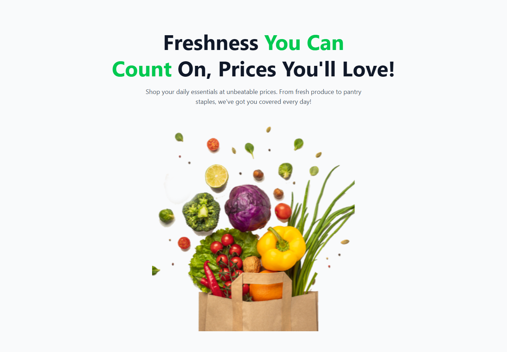

# 🥬 Nature's Platter

**Nature's Platter** is a responsive landing page for an online grocery store. It is built with HTML and Tailwind CSS from a Figma design, and it shows fresh produce, store services and popular products in a clean green look.

🔗 **Live Site:** [nature-s-platter-b14-m25.vercel.app](https://nature-s-platter-b14-m25.vercel.app/)



---

## 🛠️ Technologies Used

- **HTML5**: page structure and semantic markup
- **Tailwind CSS v4**: utility-first styling, loaded through the `@tailwindcss/browser` CDN
- **Figma**: the source design (`Nature's Platter.fig`)
- **Vercel**: hosting and deployment

## ✨ Core Features

- **Hero section:** a large headline ("Freshness You Can Count On, Prices You'll Love!") with a full-width grocery bag image.
- **Services section:** three cards for *24/7 Services*, *Fast Delivery* and *Healthy Products*, each with an icon.
- **Popular Products section:** a promotional "30% off" banner with a gradient background and a **Buy Now** button, next to a grid of product cards (onion, tomato, potato) that show a rating and a price.
- **Responsive layout:** the grids stack on mobile and expand to 2, 3 or 4 columns on tablet and desktop screens.
- **No build step:** Tailwind runs in the browser, so the page works straight from `index.html`.

## 📦 Dependencies

This project has no npm dependencies. The only external resource is:

| Dependency | Version | Source |
| --- | --- | --- |
| [`@tailwindcss/browser`](https://tailwindcss.com/docs/installation/play-cdn) | 4.x | `https://cdn.jsdelivr.net/npm/@tailwindcss/browser@4` |

> You need an internet connection when you open the page so the Tailwind CDN script can load.

## 🚀 Run Locally

1. **Clone the repository**
   ```bash
   git clone https://github.com/kfreza/Nature-s-platter-b14-m25.git
   ```
2. **Go to the project folder**
   ```bash
   cd Nature-s-platter-b14-m25
   ```
3. **Open the page.** Use either option:
   - Double-click `index.html` to open it in your browser, **or**
   - In VS Code, install the **Live Server** extension, right-click `index.html` and choose **"Open with Live Server"**, **or**
   - Run a quick local server:
     ```bash
     npx serve .
     ```
     Then open the URL it prints (usually `http://localhost:3000`).

## 📁 Project Structure

```
Nature-s-platter-b14-m25/
├── assets/                 # Images, icons and logos
├── index.html              # Main landing page
├── Nature's Platter.fig    # Figma design file
└── README.md
```

## 🔗 Links

- **Live Site:** https://nature-s-platter-b14-m25.vercel.app/
- **GitHub Repository:** https://github.com/kfreza/Nature-s-platter-b14-m25
- **Tailwind CSS Docs:** https://tailwindcss.com/docs
